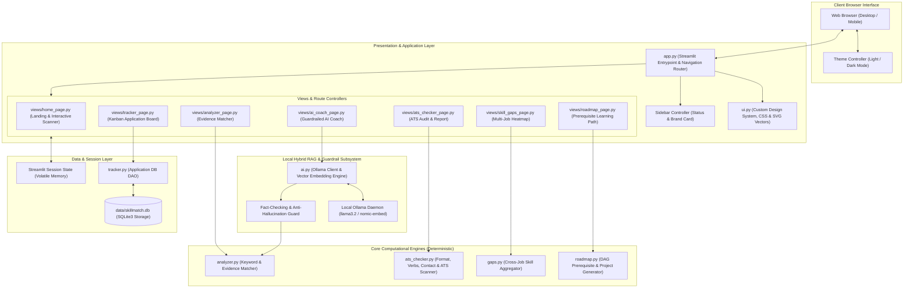
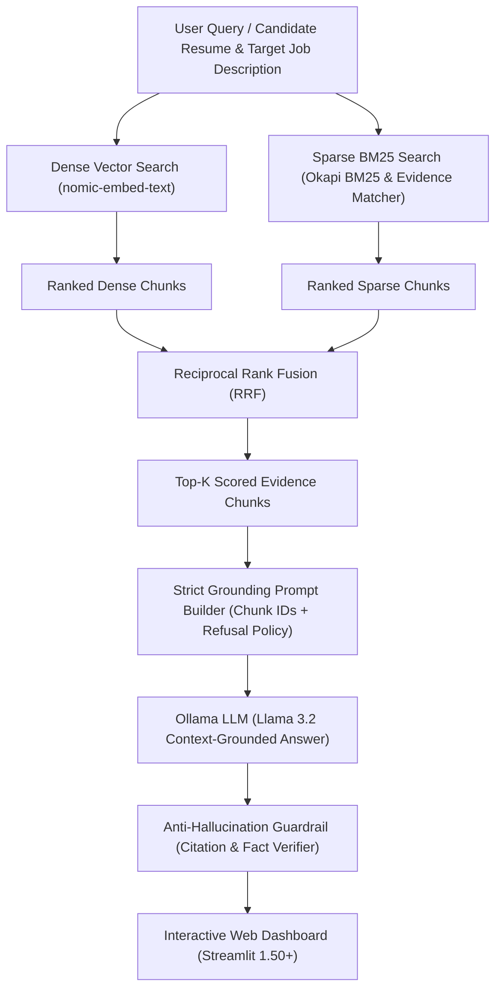
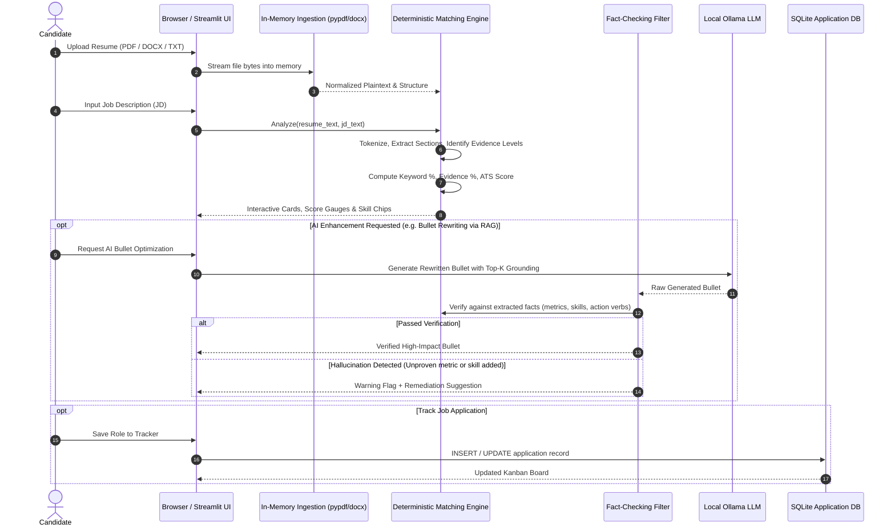
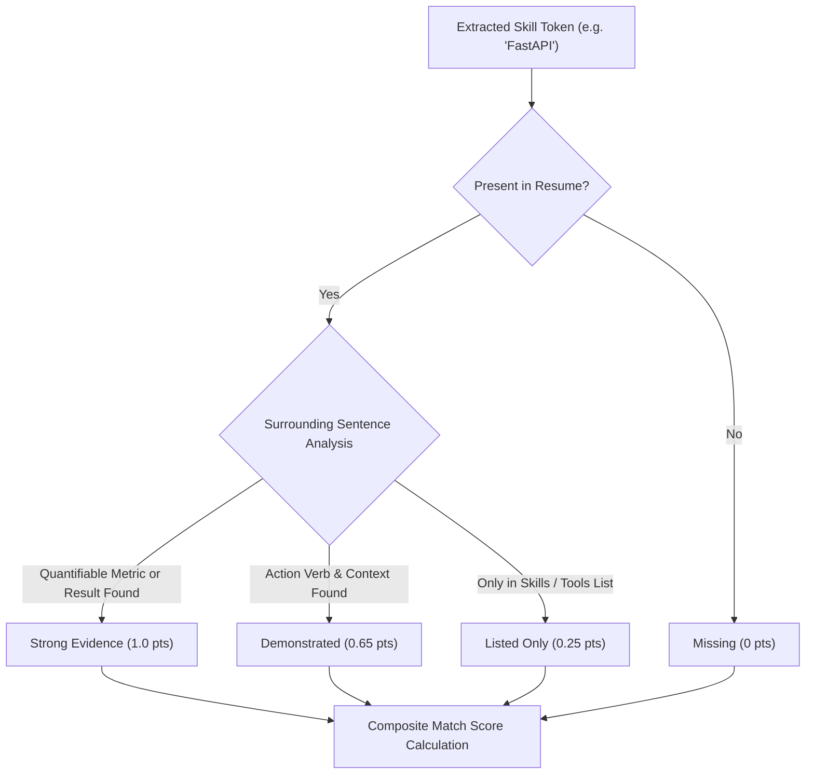
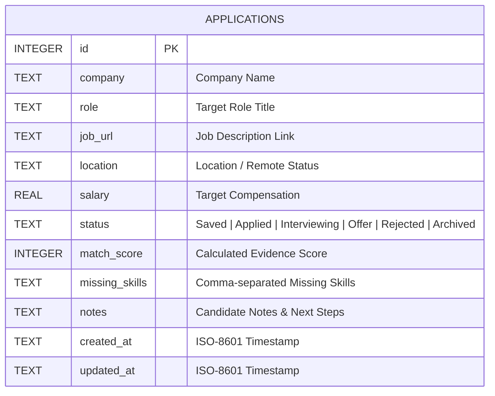

# ResuMate AI — System Architecture & Technical Specification

> **Platform**: ResuMate AI (formerly SkillMatch AI)  
> **Type**: Privacy-First, Evidence-Based Career Intelligence, Hybrid RAG & ATS Optimization Platform  
> **Version**: 2.0.0  
> **Runtime**: Python 3.10+ / Streamlit 1.50+ / SQLite3 / Optional Local Ollama (Llama 3.2 + nomic-embed-text)

---

## 1. Executive Summary & Design Philosophy

ResuMate AI is an evidence-backed career companion engineered to bridge the gap between job seekers and applicant tracking systems (ATS). Unlike conventional keyword counters that induce false confidence, ResuMate evaluates whether competencies are **quantifiably proven**, **demonstrated**, or merely **listed**.

### Core Architecture Pillars

1. **Privacy-First & Zero-Cloud Ingestion**: Resumes are parsed directly in volatile memory and never persisted to disk or transmitted to third-party cloud servers.
2. **Deterministic Ground Truth**: All matching scores, ATS compliance metrics, and gap analyses are calculated through deterministic algorithms with unit-test guarantees.
3. **Hybrid RAG & Semantic Retrieval**: Combines dense vector embeddings (`nomic-embed-text`) with sparse lexical matching (Okapi BM25 heuristics) fused via Reciprocal Rank Fusion (RRF).
4. **Guardrailed Local AI**: Generative AI features (bullet rewrites, semantic synthesis) run strictly through local LLMs ([Ollama](https://ollama.com)) and pass through automated fact-checking engines that prevent hallucinations.
5. **Decoupled Architecture**: Pure computational engines (`analyzer.py`, `ats_checker.py`, `gaps.py`, `roadmap.py`) have zero Streamlit dependencies, ensuring complete testability and CLI/API portability.

---

## 2. High-Level Architecture Blueprint

---

## 3. Hybrid RAG & Guardrailed LLM Pipeline

ResuMate AI incorporates a complete **Hybrid Retrieval-Augmented Generation (Hybrid RAG)** architecture ensuring that candidates receive credit for both verbatim technical terms and conceptually related experience:

### 1. Dual-Path Retrieval
- **Dense Vector Retrieval (`nomic-embed-text`)**: Generates 768-dimensional embeddings for both parsed resume bullet chunks and target job requirement sentences. Cosine similarity surfaces semantic alignments that lack exact keyword matches (e.g. *"developed scalable event-driven workers"* $\leftrightarrow$ *"RabbitMQ message queuing"*).
- **Sparse BM25 & Lexical Matcher**: Evaluates exact technical keywords, tool names, and evidence categories (*Strong*, *Demonstrated*, *Listed Only*) using frequency analysis and section heuristics.

### 2. Reciprocal Rank Fusion (RRF)
To unify dense semantic and sparse lexical signals, candidate evidence chunks are merged via Reciprocal Rank Fusion:

$$RRF(d) = \frac{\alpha}{k + r_{\text{dense}}(d)} + \frac{1 - \alpha}{k + r_{\text{sparse}}(d)}$$

Where:
- $r_{\text{dense}}(d)$ is the rank position in the semantic vector search.
- $r_{\text{sparse}}(d)$ is the rank position in the lexical/evidence matcher.
- $k = 60$ is the standard smoothing constant preventing high-rank domination.
- $\alpha \in [0, 1]$ balances semantic similarity against exact lexical presence.

### 3. Strict Grounding Prompt Builder
The Top-K fused evidence chunks are formatted with explicit reference boundaries:
- Enforces an explicit **refusal policy** (`REWRITE_SYSTEM`, `SUMMARY_SYSTEM`).
- Prohibits the LLM from fabricating unverified metrics, new tools, or unmentioned employers.
- Inserts candidate placeholders (e.g., `[X%]` or `[number of users]`) when measurable impact is missing rather than inventing fictional data.

### 4. Local LLM Generation (`Llama 3.2`)
Inference executes strictly on-device through Ollama (`http://localhost:11434`), generating context-grounded bullet rewrites, fit summaries, and role-specific interview prep.

### 5. Anti-Hallucination Guardrail & Citation Verifier
Before any LLM-generated text reaches the user interface, it passes through an automated validation gate in [`ai.py`](ai.py):
- **Metric Verification**: Compares extracted numerical metrics against the original bullet. Any invented number causes an immediate rejection and regeneration.
- **Skill Verification**: Scans generated text for technical skills not present in the source facts.
- **Sentence Faithfulness Score**: Rejects responses exceeding acceptable token drift.

---

## 4. End-to-End Data Flow Pipeline

---

## 5. Module Decomposition & Responsibilities

| Layer / Module | Primary File | Core Responsibilities & Algorithms | External Dependencies |
| :--- | :--- | :--- | :--- |
| **Routing & App Shell** | [`app.py`](file:///c:/Users/Siddharth%20kumar/Documents/resume-job-matching-04/app.py) | Streamlit multi-page router (`st.navigation`), session initialization, global sidebar brand card, memory status indicator. | `streamlit` |
| **Design System** | [`ui.py`](file:///c:/Users/Siddharth%20kumar/Documents/resume-job-matching-04/ui.py) | Responsive CSS injection, light/dark theme switcher, SVG vector generation (`brand_logo`, `ai_coach_logo`), custom HTML widgets. | Pure Python + CSS |
| **Resume & Skill Analyzer** | [`analyzer.py`](file:///c:/Users/Siddharth%20kumar/Documents/resume-job-matching-04/analyzer.py) | Evidence-based classification: `strong` (metric/result backed), `demonstrated` (contextual use), and `unproven` (listed only). Text extraction from PDF/DOCX. | `pypdf`, `python-docx` |
| **ATS Compliance Engine** | [`ats_checker.py`](file:///c:/Users/Siddharth%20kumar/Documents/resume-job-matching-04/ats_checker.py) | Full ATS heuristic suite: parse rate, contact detection, action verb density, measurable results percentage, hazard checks, text audit report generator. | Pure Python / Regex |
| **Skill Gap Analyzer** | [`gaps.py`](file:///c:/Users/Siddharth%20kumar/Documents/resume-job-matching-04/gaps.py) | Aggregates skill deficits across up to 10 job descriptions, computes frequency weights, outputs heatmap matrices. | Pure Python |
| **Roadmap Planner** | [`roadmap.py`](file:///c:/Users/Siddharth%20kumar/Documents/resume-job-matching-04/roadmap.py) | Directed acyclic graph (DAG) of technical competencies, prerequisite scheduling, hands-on portfolio project templates. | Pure Python |
| **Application Tracker** | [`tracker.py`](file:///c:/Users/Siddharth%20kumar/Documents/resume-job-matching-04/tracker.py) | SQLite-backed job application pipeline (Saved $\rightarrow$ Applied $\rightarrow$ Interviewing $\rightarrow$ Offer $\rightarrow$ Rejected $\rightarrow$ Archived). | `sqlite3` |
| **Local AI & RAG Engine** | [`ai.py`](file:///c:/Users/Siddharth%20kumar/Documents/resume-job-matching-04/ai.py) | Ollama HTTP client (`llama3.2`, `nomic-embed-text`), dense embeddings, cosine similarity, deterministic hallucination verification. | `urllib` / Ollama API |

---

## 6. Evidence-Based Scoring Algorithm

Rather than counting simple string occurrences, ResuMate implements a tripartite evidence classification model:

### Mathematical Formulation

Given required skills set $R$ and nice-to-have skills set $N$, where each skill $s$ has evidence weight $w(s) \in \{0.0, 0.25, 0.65, 1.0\}$:

$$\text{Evidence Score} = \frac{0.75 \sum_{s \in R} w(s) + 0.25 \sum_{s \in N} w(s)}{0.75 |R| + 0.25 |N|} \times 100$$

---

## 7. Data Storage & Schema Design

Application tracking is persisted in local SQLite storage at `data/skillmatch.db` (customizable via `SKILLMATCH_DB` environment variable):

---

## 8. Security, Privacy & Runtime Topology

- **Network Isolation**: The application operates completely air-gapped from cloud data processors. Resume bytes reside solely in volatile Python heap space during the Streamlit session and are discarded upon page reload or session close.
- **Client-Side Rendering**: Custom theme preferences are stored in the user's browser `localStorage` without tracking cookies.
- **Portability**: Packaged to run seamlessly via Docker Dev Containers (`.devcontainer/devcontainer.json`), standard Python virtual environments (`venv`), or self-hosted intranet instances.
