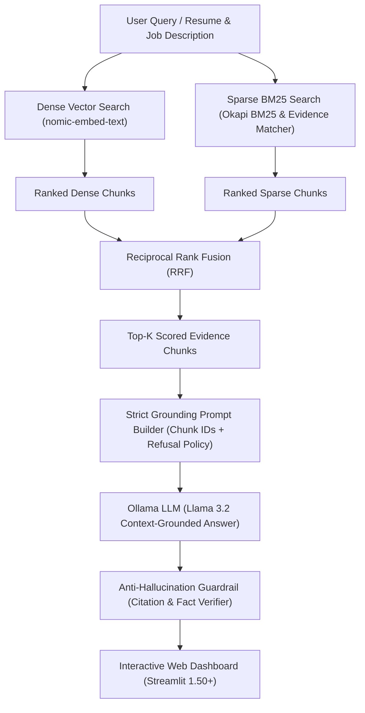

# 🚀 ResuMate AI

> **Privacy-First, Evidence-Based Career Intelligence, Hybrid RAG & ATS Resume Optimization**

[](https://www.python.org/)
[](https://streamlit.io/)
[](https://ollama.com/)
[](#-hybrid-rag--guardrailed-llm-pipeline)
[](https://pytest.org/)
[](#-privacy--security)
[](LICENSE)

**ResuMate AI** is an intelligent, privacy-first career copilot that bridges the gap between candidates and applicant tracking systems (ATS). Unlike conventional keyword matchers that give false confidence, ResuMate implements a **Hybrid Retrieval-Augmented Generation (Hybrid RAG) and deterministic auditing engine** to evaluate whether competencies are **quantifiably proven**, **demonstrated in context**, or merely **listed**.

---

## 🏛️ System Architecture

ResuMate AI is designed with a decoupled architecture separating the presentation layer, deterministic analytical engines, in-memory state, and an optional local generative AI subsystem.


---

## 🔬 Hybrid RAG & Guardrailed LLM Pipeline

The AI coaching and semantic matching subsystem uses a **Dual-Path Hybrid Search (Dense Vector + Sparse BM25) with Reciprocal Rank Fusion (RRF)** and an **Anti-Hallucination Fact-Checking Guardrail**:



### 1. Dual-Path Retrieval
- **Dense Vector Search (`nomic-embed-text`)**: Embeds job requirements and candidate experience bullets into high-dimensional vector spaces, computing cosine similarity to surface matches by underlying meaning (e.g. *"orchestrated container clusters"* $\leftrightarrow$ *"Kubernetes administrator"*).
- **Sparse BM25 & Lexical Matcher**: Evaluates exact technical keywords, tool names, and evidence categories (*Strong*, *Demonstrated*, *Listed Only*) using frequency analysis and section heuristics.

### 2. Reciprocal Rank Fusion (RRF)
Combines dense semantic and sparse lexical rankings to ensure candidates receive credit for both verbatim skills and conceptual experience:

$$RRF(d) = \frac{\alpha}{k + r_{\text{dense}}(d)} + \frac{1 - \alpha}{k + r_{\text{sparse}}(d)}$$

*(where $k = 60$ is the standard smoothing constant and $\alpha$ balances dense semantic similarity vs. exact keyword presence).*

### 3. Strict Grounding Prompt Builder
Injects retrieved candidate chunks with strict reference boundaries:
- Enforces an explicit **refusal policy** (`REWRITE_SYSTEM`, `SUMMARY_SYSTEM`).
- Prohibits the LLM from creating unverified metrics, new tools, or unmentioned employers.
- Inserts candidate placeholders (e.g., `[X%]` or `[number of users]`) when measurable impact is missing rather than inventing fictional data.

### 4. Local LLM Generation (`Llama 3.2`)
Runs on-device via local Ollama inference (`http://localhost:11434`), generating context-grounded bullet rewrites, fit summaries, and role-specific interview prep.

### 5. Anti-Hallucination Guardrail
Before any LLM-generated output reaches the UI, it passes through an automated validation gate in [`ai.py`](ai.py):
- **Metric Verification**: Compares extracted numerical metrics against the original bullet. Any invented number causes an immediate rejection and regeneration.
- **Skill Verification**: Scans generated text for technical skills not present in the source facts.
- **Sentence Faithfulness Score**: Rejects responses exceeding acceptable token drift.

---

## ✨ Core Features

- **Resume Analyzer**: Dual-input comparison against target job descriptions with keyword match % and evidence-backed scoring.
- **Evidence-Based Classification**: Skills are categorized into:
  - 🟢 **Strong**: Proven with quantifiable metrics or project outcomes.
  - 🟡 **Demonstrated**: Contextually used in work experience.
  - ⚪ **Listed Only**: Mentioned only in a skills list without supporting context.
- **Dedicated ATS Checker**: Evaluates parse rate, header formatting, contact info completeness, action verb density, measurable achievement percentages, and generates downloadable audit reports.
- **Cross-Job Skill Gaps**: Compare one resume against up to 10 job descriptions simultaneously with ranked frequency charts and heatmaps.
- **Kanban Application Tracker**: SQLite-backed pipeline tracking applications from *Saved* $\rightarrow$ *Applied* $\rightarrow$ *Interviewing* $\rightarrow$ *Offer* $\rightarrow$ *Rejected*.
- **Learning Roadmap**: DAG-based prerequisite roadmap with hands-on portfolio projects and copyable resume bullet templates.
- **AI Coach with RAG & Guardrails**: On-device LLM assistance for bullet rewrites, fit summaries, and mock interview prep—all verified by deterministic anti-hallucination checks.

---

## 🔒 Privacy & Security

- **100% In-Memory Processing**: Uploaded resumes (`.pdf`, `.docx`, `.txt`) are parsed strictly in volatile memory. No resume bytes are ever saved to disk or transmitted to external servers.
- **Air-Gapped AI**: The AI Coach connects only to your local Ollama instance (`http://localhost:11434`), ensuring complete confidentiality.

---

## 🚀 Quickstart

### 1. Clone & Setup Environment

```bash
git clone https://github.com/siddharthskyhub/resume-screening-.git
cd resume-screening-

# Create virtual environment
python -m venv venv

# Activate virtual environment
# Windows:
venv\Scripts\activate
# macOS/Linux:
source venv/bin/activate

# Install dependencies
pip install -r requirements.txt
```

### 2. Run the Live Demo

```bash
streamlit run app.py
```
Open **[http://localhost:8501](http://localhost:8501)** in your browser.

---

## 🤖 Enable Local AI & RAG Subsystem

The AI Coach and Semantic Matcher are powered by local open-weight models via [Ollama](https://ollama.com):

```bash
# 1. Install Ollama from https://ollama.com
# 2. Pull the recommended lightweight models:
ollama pull llama3.2          # Context-grounded generation
ollama pull nomic-embed-text  # Dense vector search & RAG embeddings
```

Once running, navigate to the **AI Coach** tab—it auto-detects Ollama at `http://localhost:11434`.

---

## 🧪 Testing

The platform includes a comprehensive unit test suite:

```bash
pytest
```

---

## 📁 Repository Structure

```text
├── app.py                  # Main application router & sidebar brand card
├── ARCHITECTURE.md         # Detailed architectural specification & design blueprint
├── analyzer.py             # Deterministic resume parsing & evidence matching engine
├── ats_checker.py          # Dedicated ATS compliance, heuristics & report generator
├── gaps.py                 # Multi-role skill gap aggregator & heatmap logic
├── roadmap.py              # Directed acyclic graph (DAG) learning roadmap planner
├── tracker.py              # SQLite DAO & job application pipeline logic
├── ai.py                   # Local Ollama RAG client & anti-hallucination validator
├── ui.py                   # Custom design system, CSS injection & 3D vector logos
├── views/                  # Streamlit view controllers
│   ├── home_page.py        # Landing page with interactive scanner widget
│   ├── analyzer_page.py    # Resume & JD evidence analyzer
│   ├── ats_checker_page.py # ATS test bench & audit report generator
│   ├── skill_gaps_page.py  # Multi-job gap analysis & heatmaps
│   ├── tracker_page.py     # SQLite Kanban application tracker
│   ├── roadmap_page.py     # Skill development roadmap & project templates
│   └── ai_coach_page.py    # Fact-checked local AI career assistant
├── tests/
│   ├── test_ai.py          # Anti-hallucination & Ollama client unit tests
│   └── test_ats_checker.py # ATS heuristics & scoring unit tests
└── data/                   # Local SQLite storage (skillmatch.db)
```

---

## 📄 License

Distributed under the MIT License. Built as an open portfolio project by **Siddharth Kumar**.
