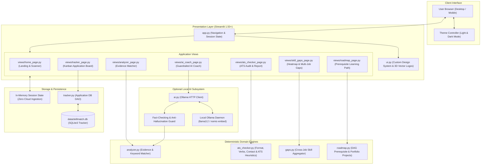

# 🚀 ResuMate AI

> **Privacy-First, Evidence-Based Career Intelligence & ATS Resume Matching**

[](https://www.python.org/)
[](https://streamlit.io/)
[](https://pytest.org/)
[](#privacy--security)
[](LICENSE)

**ResuMate AI** is an intelligent career copilot that bridges the gap between candidates and applicant tracking systems (ATS). Unlike conventional keyword matchers that give false confidence, ResuMate analyzes whether your competencies are **quantifiably proven**, **demonstrated in context**, or merely **listed**.

---

## 🏛️ System Architecture

ResuMate AI is designed with a decoupled architecture that cleanly separates presentation, deterministic analytical engines, and an optional local generative AI subsystem.



> 📖 **Deep Dive**: For full sequence diagrams, scoring formulas, data models, and component specifications, read the complete [**ARCHITECTURE.md**](ARCHITECTURE.md).

---

## ✨ Core Features

- **Resume Analyzer**: Dual-input comparison against target job descriptions with keyword match % and evidence-backed scoring.
- **Evidence-Based Classification**: Skills are categorized into:
  - 🟢 **Strong**: Proven with quantifiable metrics or project outcomes.
  - 🟡 **Demonstrated**: Contextually used in work experience.
  - ⚪ **Listed Only**: Mentioned only in a skills list without supporting context.
- **Dedicated ATS Checker**: Evaluates parse rate, header formatting, contact info completeness, action verb density, measurable achievement percentages, and generates downloadable audit reports.
- **Cross-Job Skill Gaps**: Compare one resume against up to 10 job descriptions simultaneously with ranked frequency charts and heatmaps.
- **Kanban Application Tracker**: SQLite-backed pipeline tracking applications from *Saved* $\rightarrow$ *Applied* $\rightarrow$ *Interviewing* $\rightarrow$ *Offer* $\rightarrow$ *Rejected*.
- **Learning Roadmap**: DAG-based prerequisite roadmap with hands-on portfolio projects and copyable resume bullet templates.
- **Guardrailed AI Coach (Local Ollama)**: Optional local LLM for bullet rewrites, fit summaries, and mock interview prep—all verified by deterministic anti-hallucination checks.

---

## 🔒 Privacy & Security

- **100% In-Memory Processing**: Uploaded resumes (`.pdf`, `.docx`, `.txt`) are parsed strictly in volatile memory. No resume bytes are ever saved to disk or transmitted to external servers.
- **Air-Gapped AI**: The AI Coach connects only to your local Ollama instance (`http://localhost:11434`), ensuring complete confidentiality.

---

## 🚀 Quickstart

### 1. Clone & Setup Environment

```bash
git clone https://github.com/siddharthskyhub/resume-screening-.git
cd resume-screening-

# Create virtual environment
python -m venv venv

# Activate virtual environment
# Windows:
venv\Scripts\activate
# macOS/Linux:
source venv/bin/activate

# Install dependencies
pip install -r requirements.txt
```

### 2. Run the Live Demo

```bash
streamlit run app.py
```
Open **[http://localhost:8501](http://localhost:8501)** in your browser.

---

## 🤖 Optional: Enable Local AI Coach

The AI Coach is powered by local open-weight models via [Ollama](https://ollama.com):

```bash
# 1. Install Ollama from https://ollama.com
# 2. Pull the recommended lightweight models:
ollama pull llama3.2          # Fast, high-quality reasoning
ollama pull nomic-embed-text  # Dense vector embeddings
```

Once running, navigate to the **AI Coach** tab—it auto-detects Ollama at `http://localhost:11434`.

---

## 🧪 Testing

The platform includes a comprehensive unit test suite:

```bash
pytest
```

---

## 📁 Repository Structure

```text
├── app.py                  # Main application router & sidebar brand card
├── ARCHITECTURE.md         # Detailed architectural specification & design blueprint
├── analyzer.py             # Deterministic resume parsing & evidence matching engine
├── ats_checker.py          # Dedicated ATS compliance, heuristics & report generator
├── gaps.py                 # Multi-role skill gap aggregator & heatmap logic
├── roadmap.py              # Directed acyclic graph (DAG) learning roadmap planner
├── tracker.py              # SQLite DAO & job application pipeline logic
├── ai.py                   # Local Ollama client & anti-hallucination validator
├── ui.py                   # Custom design system, CSS injection & 3D vector logos
├── views/                  # Streamlit view controllers
│   ├── home_page.py        # Landing page with interactive scanner widget
│   ├── analyzer_page.py    # Resume & JD evidence analyzer
│   ├── ats_checker_page.py # ATS test bench & audit report generator
│   ├── skill_gaps_page.py  # Multi-job gap analysis & heatmaps
│   ├── tracker_page.py     # SQLite Kanban application tracker
│   ├── roadmap_page.py     # Skill development roadmap & project templates
│   └── ai_coach_page.py    # Fact-checked local AI career assistant
├── tests/
│   ├── test_ai.py          # Anti-hallucination & Ollama client unit tests
│   └── test_ats_checker.py # ATS heuristics & scoring unit tests
└── data/                   # Local SQLite storage (skillmatch.db)
```

---

## 📄 License

Distributed under the MIT License. Built as an open portfolio project by **Siddharth Kumar**.
